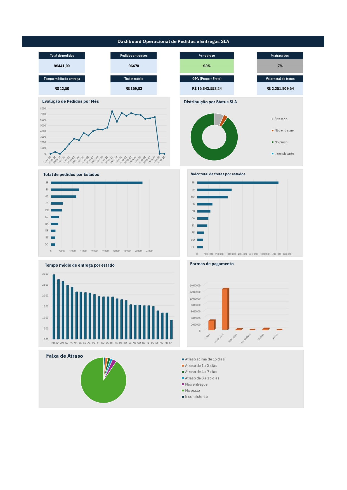

# Análise operacional de pedidos e entregas na Olist

Estudo exploratório da operação logística do marketplace Olist com o *Brazilian E-Commerce Public Dataset*. O fluxo documentado usa Power Query para preparar e consolidar os dados e Excel para organizar indicadores, tabelas dinâmicas e um dashboard gerencial.

[Ver a imagem em tamanho original](03_dashboard/dashboard.jpg)

## O projeto em 30 segundos

A análise cobre **99.441 pedidos**, de setembro de 2016 a agosto de 2018. O foco é acompanhar o volume de pedidos, o cumprimento do prazo de entrega, o tempo de entrega, o frete, a distribuição geográfica e as avaliações dos clientes. A entrega principal é uma planilha Excel com dashboard, acompanhada de relatório executivo e documentação técnica.

## Pergunta de negócio

Como a operação de pedidos e entregas se comportou nesse período, e quais recortes ajudam a investigar atrasos e a experiência registrada pelos clientes? O projeto organiza esses indicadores para apoiar uma leitura operacional da amostra — não para avaliar a operação atual da Olist.

## Dados e ferramentas

A fonte indicada nos materiais é o **Brazilian E-Commerce Public Dataset by Olist**, distribuído pelo Kaggle. Os arquivos CSV estão em [`01_base_dados/`](01_base_dados/). O conjunto cobre pedidos, itens, pagamentos, avaliações, clientes, produtos, vendedores, geolocalização e tradução de categorias.

- **Power Query:** preparação e consolidação das tabelas.
- **Microsoft Excel:** fórmulas, base tratada, tabelas dinâmicas e dashboard.
- **Análise descritiva:** acompanhamento de indicadores operacionais e recortes por período e localização.

O fluxo descrito na documentação é, em linhas gerais: **CSV → Power Query → base tratada por pedido → indicadores e tabelas dinâmicas → dashboard**. A agregação de itens e pagamentos antes da consolidação é documentada como forma de respeitar a granularidade dessas tabelas.

## Leituras apresentadas

O relatório organiza análises temporais e regionais de pedidos, atrasos, frete e avaliações. Os padrões são descritivos: a coincidência entre dois comportamentos na amostra não demonstra que um causou o outro. Recomendações e estimativas de cenário apresentadas no relatório devem ser lidas como hipóteses para investigação, não como efeitos de intervenções testadas.

Os materiais apresentam alguns indicadores com critérios e arredondamentos diferentes. Para evitar uma síntese numérica ambígua, este README não replica esses percentuais nem valores financeiros. A planilha e o relatório continuam disponíveis para consulta; a reconciliação dos indicadores deve preceder qualquer divulgação de um número único.

## Limites da análise

- Os dados são históricos e cobrem setembro de 2016 a agosto de 2018; não representam a operação atual.
- A análise é exploratória e descritiva. Não estima causalidade nem testa o efeito de ações operacionais.
- Os registros disponíveis não identificam, por si só, a causa de cada pedido sem entrega registrada.
- As recomendações do relatório são pontos de investigação, não decisões já validadas pela Olist.

## Explore os materiais

A planilha tem aproximadamente **85 MB**; baixe o arquivo para abri-lo no Excel. Os documentos complementares estão disponíveis em Markdown para leitura direta no GitHub; os arquivos Word originais também foram mantidos.

| Material | O que você encontra |
|---|---|
| [Planilha e dashboard](02_planilhas/analise_operacional_pedidos_entregas_sla.xlsx) | Arquivo principal da análise operacional. |
| [Prévia do dashboard](03_dashboard/dashboard.jpg) | Captura do painel com indicadores e gráficos. |
| [Relatório executivo (Markdown)](04_relatorio_executivo/relatorio_executivo.md) · [Word original](<04_relatorio_executivo/Relatório Executivo_ Olist E-Commerce.docx>) | Contexto, indicadores, interpretações e recomendações do estudo. |
| [Dicionário de dados (Markdown)](05_documentacao_tecnica/dicionario_de_dados.md) · [Word original](05_documentacao_tecnica/Dicionario_de_Dados_Olist.docx) | Descrição das tabelas, campos, camadas e relacionamentos documentados. |
| [Fórmulas e KPIs (Markdown)](05_documentacao_tecnica/formulas_kpis.md) · [Word original](05_documentacao_tecnica/Formulas_KPIs.docx) | Definições e fórmulas dos indicadores descritos no projeto. |

## Estrutura do repositório

- `01_base_dados/` — arquivos CSV do dataset.
- `02_planilhas/` — planilha de análise em Excel.
- `03_dashboard/` — captura do dashboard.
- `04_relatorio_executivo/` — relatório complementar.
- `05_documentacao_tecnica/` — dicionário de dados e documentação de KPIs.

## Sobre a autora

**Karol Antunes Silva** — estudante de Sistemas de Informação e estagiária em Análise de Dados.

[LinkedIn](https://www.linkedin.com/in/karol-antunes-silva-2b9236390/) · [Contato por e-mail](mailto:karolantunes1412@gmail.com)
